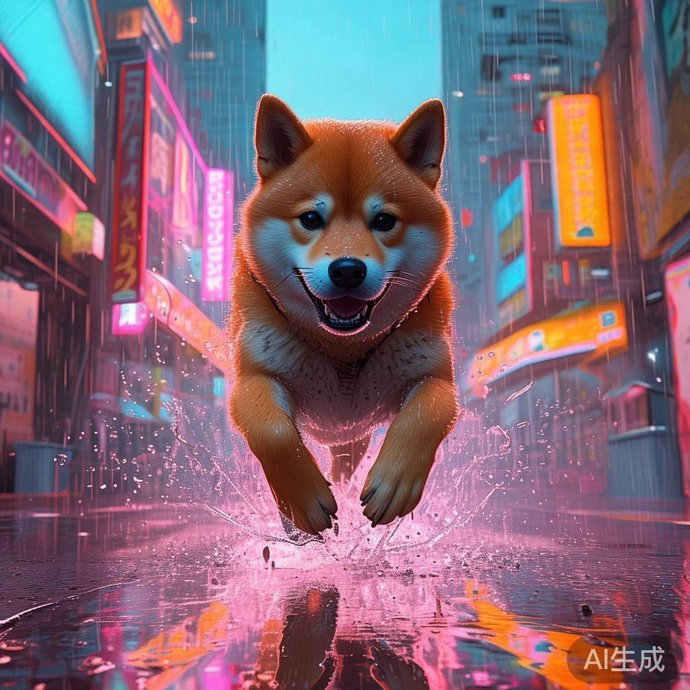

<p align="center">
  
</p>

<h1 align="center">智谱画图 · astrbot_plugin_zhipu_draw</h1>

<p align="center">
  <b>免费</b>给 AstrBot 加一个会画图的插件 —— 不用显卡，不用中转，不用充钱。
</p>

<p align="center">
  
  
  
  
</p>

---

## 先说清楚：这是免费插件，但你需要自备一把 Key

- 插件本身 **完全免费**，没有付费版、没有隐藏额度。
- 画图调用的是智谱开放平台 **目前免费的 GLM 绘画模型** `cogview-3-flash`（智谱官方给的免费额度，不是逆向接口，不会哪天突然挂掉）。
- **你需要自己去智谱开放平台注册并申请一把 API Key**，填进插件配置里，插件才有权调用这个模型。这一步不花钱，注册只要手机号。
- 免费模型的唯一代价：图片右下角会打一个「AI生成」水印，尺寸是固定几档。

### 五分钟拿到 Key

1. 打开 <https://bigmodel.cn> ，用手机号注册 / 登录。
2. 右上角头像 → **API Keys** → **新建**。
3. 复制整串 Key。**它长这样：`32 位字符 + 一个点 + 16 位字符`**，例如 `abcd1234...ef01.Xy9kLm3QpR7sT2uV`。只复制点号前面那半段会一直 401。
4. 回到 AstrBot WebUI → 插件 → 智谱画图 → 配置，把 Key 粘进「智谱 API Key」，保存。

## 它能干什么

- `/画图 一只橘猫趴在窗台上晒太阳，水彩风` —— 手动出图
- 聊天里直接说「帮我画一只柴犬」—— Bot 判断该画时自己调用 `generate_image` 工具，把图画出来再接着跟你聊



## 为什么用它

| | 智谱 CogView-3-Flash | 本地 SD / ComfyUI | 各类逆向接口 |
|---|---|---|---|
| 需要显卡 | 否 | 是 | 否 |
| 需要付费 | 否（免费额度） | 电费 | 不稳定 |
| 接口稳定性 | 官方 API | 看部署 | 随时失效 |
| 出图速度 | 10–60 秒 | 看机器 | 看运气 |

## 安装

### 方式一：插件市场

AstrBot WebUI → 插件 → 搜索「智谱画图」→ 安装。

### 方式二：手动

```bash
cd /AstrBot/data/plugins
git clone https://github.com/DrTreey/astrbot_plugin_zhipu_draw.git
```

装完重启 AstrBot。

## 配置项

| 配置项 | 默认值 | 说明 |
|---|---|---|
| `api_key` | 空 | **必填**，智谱开放平台的 Key |
| `model` | `cogview-3-flash` | 免费模型；`cogview-4` 效果更好但收费 |
| `size` | `1024x1024` | 支持 7 档尺寸，非法值自动回退 |
| `quality` | `standard` | 仅 `cogview-4` 生效，可设 `hd` |
| `timeout` | `120` | 单次请求超时（秒） |
| `allow_auto_draw` | `true` | 关掉后只能手动 `/画图` |
| `cooldown_seconds` | `10` | 同一会话的冷却时间，防刷屏 |
| `max_concurrency` | `2` | 同时进行中的画图任务上限 |
| `max_keep_files` | `200` | 本地图片保留数量，超出删最旧的 |
| `save_dir` | `plugin_data/astrbot_plugin_zhipu_draw` | 图片存放目录 |

## 使用

```
/画图 雨夜的赛博朋克街道，一只柴犬正在奔跑，霓虹灯反射在积水上
/画图 竖版海报，樱花树下的少女，浅粉色，胶片质感
```

支持的尺寸：`1024x1024` `768x1344` `864x1152` `1344x768` `1152x864` `1440x720` `720x1440`

别名：`/绘图`、`/画画`、`/智谱画图`、`/cogview`

## 常见问题

**401 / 1001 / 1002：Key 不对**
确认复制完整，智谱的 Key 是「32 位 ID + 一个点 + 16 位密钥」，只复制前半段会 401。

**1301：内容审核没过**
换个说法。真人明星、版权角色名、性暗示、暴力血腥的描述容易被拦。

**1303 / 1304：并发或额度超了**
把 `max_concurrency` 改成 1，或等一会儿再试。免费额度有每日上限。

**图片有水印**
`cogview-3-flash` 免费，右下角固定带「AI生成」。想要无水印要换付费模型。

**为什么图是 jpg 而不是 png**
智谱有时返回 JPEG，插件按文件头判断真实格式再存盘，扩展名和内容一致。

## 开发

```
astrbot_plugin_zhipu_draw/
├── main.py             # 指令、LLM 工具、接口调用
├── metadata.yaml       # 插件元信息
├── _conf_schema.json   # WebUI 配置项
├── docs/               # logo 与示例图
├── README.md
├── CHANGELOG.md
└── LICENSE
```

没有第三方依赖，只用 `aiohttp`（AstrBot 自带）。

## 许可证

MIT
